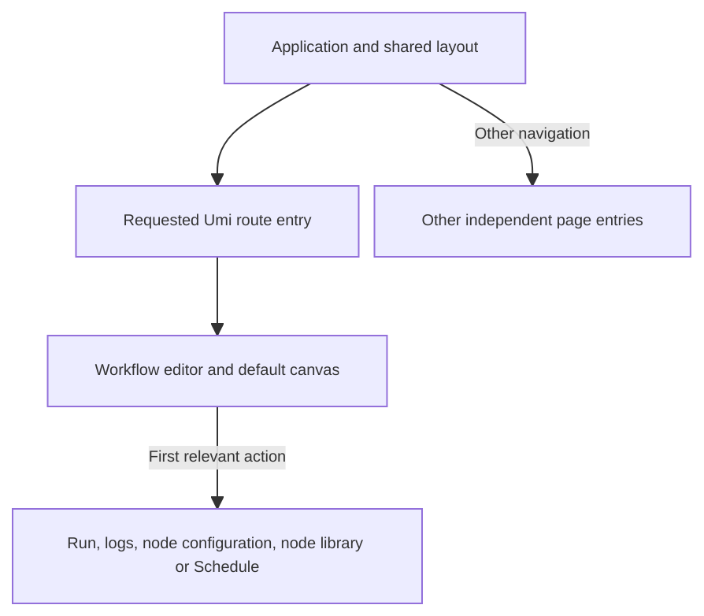

# Workflow detail loading boundaries

## Problem and scope

The canonical workflow detail URL is
`/scopes/:scopeId/workflows/:workflowId`. The previous Umi route configuration
mapped all 11 scoped resource routes to one module. That module statically
imported Workflows, creation, templates, Activity, Run detail, Channels and
Settings. Umi split the module from the application entry, but opening any
one of these routes downloaded the whole business area.

The editor also statically imported its closed Run, execution logs, node
configuration, node library and Schedule panels. This work changes loading
boundaries while retaining the existing default canvas and API contracts.

A separate build defect delayed route discovery: Umi 4.6.33 generated its
preload map in ascending route-specificity order. Its first-match lookup
therefore selected `/*` for parameterized scoped URLs, preloading the 404 page
instead of the requested editor and layout.

## Design-baseline declaration

- Primary visual and interaction reference:
  `design-baselines/workflow-activity-vnext/aevatar-workflow-activity-vnext.excalidraw`.
- Main Excalidraw SHA-256:
  `30e74d7b410ae72c4c91432355436679033679c54c10b1702908435b001577de`.
- Schedule Excalidraw SHA-256:
  `cd5c84c45ffb0cdb253af31b7e1b7616504b35520298f01773026e3b76882d8a`.
- Product and identity contract:
  `superpowers/specs/2026-08-04-workflow-activity-vnext-design.md`.
- User paths:
  `superpowers/specs/2026-08-04-workflow-activity-vnext-user-paths.md`, especially
  UP-00, UP-06, UP-07 and UP-16.
- Current route precedence:
  `superpowers/specs/2026-09-21-console-entry-routes.md`.
- Runtime data still comes exclusively from real APIs and acknowledged user
  actions. No fixture, prototype persistence, timer-generated receipt or
  guessed identity enters production. Existing auth/session/returnTo and
  Umi localization own their existing contracts.

## Loading architecture

Each resource now has a separate Umi entry in
`src/pages/workflow-activity-vnext/routes/`. A small shared parser decodes route
identities and query parameters without importing pages. Bind and edit reuse
the same Channel configuration entry. No extra React.lazy dispatcher sits
between Umi and these entries.



`DeferredWorkflowPanel` loads a panel on its first activation and then leaves
visibility to that panel's existing contract, preserving local form/search
state across close/reopen where the owner keeps it mounted. Loading and error
states stay within the panel and retain a close action. Retrying a failed
chunk creates a fresh lazy component, without reloading the editor or losing
its unsaved document. Logs retain keyboard focus through loading, failure, retry and the handoff
to loaded content. Schedule retains its Drawer focus and dismissal behavior
while its content loads or fails. Canvas and ReactFlow remain part of the default editor load.

Legacy Live Ops attention reads are also loaded on demand, only when their
existing bridge is enabled. Current resource routes already disable this
bridge; they now avoid importing its Mission Control adapters through the
global application entry. The legacy polling cadence, cancellation checks,
badge store and API failure semantics remain in their existing owners.

The version-scoped pnpm patch
`patches/@umijs__preset-umi@4.6.33.patch` corrects the preload generator's sort
to descending specificity. This is a one-line build dependency correction;
the existing generator still owns the preload script, content hash and HTML
reference. pnpm applies it reproducibly through the lockfile, without hand
editing installed dependencies or generated output. On a future Umi upgrade,
review whether the upstream generator already fixes the ordering and remove
the patch only after the generated-preload checks pass.

TypeScript explicitly uses `module: esnext`, matching the existing bundler
module resolution and allowing the new `import()` boundaries to typecheck.

## Build verification and recurrence prevention

Run from the repository root:

```bash
pnpm --dir apps/aevatar-console-web build:stats
pnpm --dir apps/aevatar-console-web check:workflow-route-bundle
```

The opt-in stats build writes `dist/bundle-stats.json`, without starting an
analyzer server. The check reads the actual emitted chunk groups and uses the
union of initial chunks, the Umi layout group and the editor route group.
Shared files are counted once. It fails if another business page or a closed
editor panel enters this load graph, or if the editor/default canvas is absent.
Truncated module inventories fail instead of silently passing. The generated
HTML preload helper is executed in a bounded Node VM with a minimal resource
collector to verify deep-link, new/template and unknown-route selection. This
checks the build output without launching a browser or calling an API.

The report includes HTML scripts and actual helper-selected resources, then
gives raw bytes and local gzip estimates for JavaScript and CSS.
It excludes fonts, API responses and panels opened by the user. This is a
production-build dependency measurement, not a browser waterfall or a
Lighthouse score. Stats and generated bundles remain ignored build artifacts.

The focused route tests protect canonical route selection, resource identity
decoding and Channel query/remount behavior. The deferred-panel unit tests
protect first-use loading, retained inputs and failure/retry isolation. Existing
route integration tests load the real route adapters through a test-only
harness instead of preserving the removed production dispatcher. Route entries
retain the React runtime import required by Jest's JSX transform. Umi's existing
`jsTransformerOpts.supported` option lowers dynamic imports to deferred CommonJS
loads for Jest only; the production bundler retains real chunk boundaries.
The transform regression executes both configured Jest projects' emitted code
and verifies deferred loading and asynchronous rejection without VM ESM flags.
Template recovery tests also await actual modal visibility and clear their
queued API responses between cases to avoid cascading failures.

## Measured build comparison

Baseline: `origin/dev` at `a7f20172614bddde3d4087b57f464184db343a8c`.
Both builds use the same dependency versions, local environment and production
minifier; the final build adds the version-scoped preload ordering patch.
Gzip figures use the same Node `gzipSync` defaults and are estimates, not
observed CDN transfer sizes. KiB means 1024 bytes.

| JavaScript load set | Before raw / gzip KiB | After raw / gzip KiB | Gzip reduction |
| --- | --- | --- | --- |
| Global application entry | 2778.5 / 678.5 | 2657.4 / 648.5 | 4.4% |
| Workflow detail route group, including its shared chunks | 1407.1 / 381.2 | 683.5 / 198.1 | 48.0% |
| Cold detail: HTML scripts + entry + layout + route + actual preloads, deduplicated | 4379.9 / 1124.3 | 3526.0 / 907.7 | 19.3% |

The cold detail load drops from 4,485,015 to 3,610,668 raw JS bytes (19.5%),
and from 1,151,317 to 929,498 gzip bytes. This includes the separate HTML preload
helper and the baseline's two unnecessary 404 dependencies. The corrected
helper preloads exactly the requested editor/layout files.
The JavaScript file count rises from 13 to 18 as Webpack shares code among
independent routes. This can add request overhead on some connections, so the
byte reduction must not be equated with an identical percentage timing gain.
After the loading-state accessibility review, the final verification build
contains 3,610,858 raw JS bytes and 929,677 estimated gzip bytes (18 files).
The earlier same-environment comparison above remains the performance baseline;
these small follow-up changes retain the approximately 19.3% gzip reduction.
The global entry remains the largest payload. CSS changes only from 67,118 to
66,388 raw bytes; this patch does not claim to resolve the render-blocking CSS
audit.

The local verification commands are:

```bash
pnpm --dir apps/aevatar-console-web install --frozen-lockfile
pnpm --dir apps/aevatar-console-web exec jest --runInBand --runTestsByPath \
  src/routesConfig.test.ts \
  src/pages/workflow-activity-vnext/routes/routeParameters.test.ts \
  src/shared/workflows/DeferredWorkflowPanel.test.tsx \
  tests/jestDynamicImport.test.ts
pnpm --dir apps/aevatar-console-web exec jest --runInBand --runTestsByPath \
  src/app.layout.test.ts src/locales/catalog.test.ts \
  --testNamePattern 'renders workflow route .* without the global console chrome|keeps the English and Chinese message catalogs structurally aligned|keeps the English message catalog free of Chinese copy|keeps ICU placeholder names aligned across locales|keeps every named route backed by menu locale entries'
pnpm --dir apps/aevatar-console-web tsc
pnpm --dir apps/aevatar-console-web build:stats
pnpm --dir apps/aevatar-console-web check:workflow-route-bundle
bash tools/ci/test_stability_guards.sh
bash tools/ci/frontend_static_boundary_guard.sh
bash tools/docs/lint.sh
python3 apps/aevatar-console-web/docs/design-baselines/workflow-activity-vnext/verify-baseline.py
git diff --check
```

The local Jest preflight selected six exact test files. All 21 selected cases
passed: 11 route/parser/deferred-panel cases, five layout configuration cases
four locale contract cases and one deferred-import transform case. Ten unrelated cases in the latter two files
were excluded by the explicit name filter. Dependency-based discovery was not
used because app, router and locale entries have broad fan-out. Changed-file
Biome validation and the required static/build guards are recorded in the PR.

The full frontend suite, component/route integration tests, end-to-end tests
and smoke tests were not run locally under the task's incremental test policy.
The existing GitHub `console-web` check owns the complete Jest run, including
the changed Channel and editor test owners and the deferred-editor regression
tests. Its final status is recorded in the PR checks. Existing runtime tests do
not directly cover enabled legacy Live Ops chunk-failure retry/cancellation;
that extraction received static review and bundle-boundary verification.

New verification scenarios are deliberately limited to these distinct risks:

| Scenario | Regression protected |
| --- | --- |
| Static new/template route parsing | Reserved route names treated as workflow IDs |
| Encoded scope/workflow/run identities | Double decoding or query parameters replacing path-owned IDs |
| Channel bind query | Loss of repeated service IDs or the default skill selection |
| Channel edit/detail identity | Registration identity or remount behavior changing during route extraction |
| Deferred panel activation and close/reopen | Eager import or loss of unapplied local configuration |
| Deferred panel failure/retry | Recovery reloading the editor and losing the unsaved document |
| Jest deferred-import execution | Native ESM import escaping the CommonJS test runtime or losing asynchronous rejection |
| Logs loading/failure/retry focus | Keyboard focus or unsaved edits lost when a loading control is replaced |
| Schedule loading/failure dismissal | Missing Escape support or focus restoration while a chunk is unavailable |
| Generated preload: workflow detail | Catch-all shadowing the parameterized editor |
| Generated preload: new workflow | Dynamic editor shadowing the static creation page |
| Generated preload: templates | Broader resource patterns shadowing the deeper template route |
| Generated preload: unknown route | Specificity correction breaking the 404 fallback |

The generated-preload checks failed against the unpatched helper and passed
after the one-line dependency correction. They are part of the opt-in build
guard, not a browser test or a claim of measured loading time.

## Remaining performance boundaries

FCP still depends on the global application entry, render-blocking CSS and
session bootstrap. LCP additionally depends on the actual largest element,
remote API latency, draft/workspace reads, server YAML parsing and canvas work.
Client-only rendering remains in place. Bundle reductions alone cannot prove
an improvement in measured FCP/LCP milliseconds.

The draft response contains YAML but no typed document, so the server parse
request remains. The committed-only fallback currently reads workflow sources
from the scoped collection. Replacing it unconditionally with exact detail
would break editable NotReady/Stale resources, because that endpoint requires
runnable state. This patch preserves those read semantics.

The global ProConfigProvider import is already tree-shaken; it does not pull
every Pro component into the entry. Both locale catalogs and current browser
compatibility targets are preserved. These should be evaluated with evidence
and separate compatibility decisions if further entry reduction is required.

Authenticated browser timings and full editor journey verification remain
outside this task's permitted incremental unit-test scope. Re-run Lighthouse
on the deployed production build with the same authenticated route, device,
network/CPU throttling and cache settings to compare real FCP/LCP.
