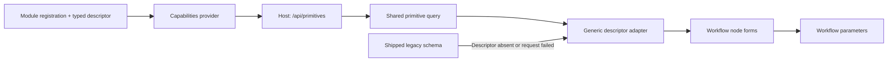

# Workflow Primitive Descriptors and Configuration Forms

Workflow module registrations own their authoring descriptors. Console node
forms derive their fields from `/api/primitives`, so adding a module or changing
its advertised parameters does not require another frontend field definition.
The descriptor is the schema contract; the frontend converts it into a generic
control model rather than maintaining a second authoritative schema.

## Ownership and data flow



- `WorkflowPrimitiveParameterDefinition` in Workflow Abstractions defines
  parameter types, controls, labels, defaults, constraints, and enum choices.
- `WorkflowModuleRegistration` accepts a `WorkflowPrimitiveDefinition` beside
  the implementation. Core registrations use `WorkflowPrimitiveDefinitions`;
  extension packs contribute their own definitions, as the schedules pack does.
- `WorkflowInfrastructureCapabilitiesProvider` combines module contributions.
  Step-type options include discovered module names and accepted runtime
  aliases. A plugin descriptor can override a built-in registration's contract.
- The Host converts typed controls to public string values. Both the primitive
  catalogue and capability response expose the same control vocabulary.
- The console decoder validates the response, and `nodeConfiguration.ts`
  derives fields. Both node panels use this codec. The older Studio field
  adapter also consumes the same derived schema.

These descriptors describe authoring. Runtime modules remain responsible for
execution semantics and runtime validation; this change does not introduce a
generic runtime parameter validator. Open plugin parameters, connector-specific
inputs and `sub_param_*` values remain editable through advanced JSON and survive
guided edits.

## Wire contract

A parameter retains `name`, `type`, `required`, `description`, `default`, and
`enumValues`. Additive authoring fields are:

| Field | Meaning |
| --- | --- |
| `label` | Default display name; the console can translate a known parameter |
| `control` | `text`, `textarea`, `number`, `boolean`, `select`, or `json` |
| `placeholder` | Example or hint, separate from the effective runtime default |
| `minimum`, `maximum` | Optional numeric constraints |
| `integer` | Whether numeric input must be an integer |

The existing wire types remain `string`, `int`, `number`, `bool`, `array`, and
`object`. Plugins may omit the authoring control in their registration; the
provider infers it from the type and enum choices. The frontend uses the
declared value type for validation and serialization even when the display
control is text. A JSON editor for a string parameter preserves a JSON string;
object and array parameters produce structured values.

For example, the backend can publish this authoring parameter:

```json
{
  "name": "duration_ms",
  "type": "int",
  "label": "Duration ms",
  "description": "",
  "required": false,
  "default": "1000",
  "enumValues": [],
  "control": "number",
  "placeholder": "",
  "minimum": 0,
  "maximum": 300000,
  "integer": true
}
```

## Fallback and editing rules

1. A matching server descriptor supplies the entire field list, including an
   explicitly empty `parameters: []`. Legacy fields are never merged into it.
2. When no descriptor matches, a known node may use the shipped
   `nodeConfigFieldSchemas.ts` definitions. The UI identifies these as built-in
   settings. A failed request offers retry; a failed refresh can keep a previously
   loaded descriptor and identifies that state.
3. A node with neither descriptor nor legacy schema uses advanced JSON. Field
   definitions are not inferred from the keys or values of an existing document.
4. Raw parameters and edited deltas are kept separately. Deltas use canonical
   parameter names, so loading or refreshing a descriptor does not reset dirty
   input, including invalid input. A removed field's pending edit remains in
   advanced JSON; validation is recomputed against the current schema.
5. Guided updates preserve unadvertised parameters. Runtime expression strings
   remain strings, optional defaults are not silently written, and separators
   retain authored whitespace. Decimal integer strings beyond JavaScript's safe
   integer range are preserved without numeric rounding.
6. Newly chosen enum values must match the advertised choices. An existing value
   left unchanged can survive editing another field, preserving runtime-supported
   aliases and casing without assuming all plugin enums ignore case.
7. Localized labels, hints, options and validation copy use the existing console
   catalogues. Known canonical parameter keys have bilingual presentation entries;
   new plugin content can use the backend-authored display text.

The legacy catalogue is retained intentionally for compatibility. It is not the
place to add ordinary new node definitions. Only its static fallback definitions
remain; duplicated inference, field merging and conversion paths were removed.

## Regression coverage and verification scope

This change spans module registrations, public DTOs, a shared codec and two
rendered editing workflows. Its focused frontend cases exceed the usual eight
case calibration because they protect distinct failure modes:

| Case | Distinct protected risk |
| --- | --- |
| Server fields replace shipped fields | Stale frontend fields override backend evolution |
| Empty server descriptor | Explicit absence is confused with a failed lookup |
| Alias matching and existing parameter preservation | Aliases fail to resolve, or guided edits discard other inputs |
| Types, bounds and enum choices | A display control bypasses typed serialization or validation |
| Expressions and absent defaults | Runtime references are coerced, or defaults are materialized |
| Missing descriptor fallback | Older or unavailable catalogues make known nodes unusable |
| JSON strings and whitespace | Round-trip conversion changes runtime input semantics |
| Large integer literals | JavaScript silently rounds a valid workflow parameter |
| Legacy adapter with remote fields | The older Studio surface keeps a parallel field source |
| Legacy fallback canonical edits | A presentation field name is written as a runtime parameter |
| Invalid JSON in the legacy adapter | An unfinished raw edit is silently accepted |
| Decoder authoring hints | The network boundary drops controls or constraints |
| Decoder unknown control rejection | Unsupported server controls produce misleading forms |
| vNext remote field editing | The rendered inspector still uses its shipped field list |
| vNext failed catalogue, edit and retry | Recovery loses invalid or dirty local input |
| vNext authoritative empty descriptor after fallback | Removed fields lose edits or retain obsolete validation errors |
| vNext delayed descriptor | Loading overwrites advanced JSON changes |
| Team fallback for a missing descriptor | The second editing entry cannot recover |
| Team alias and expression editing | Alias resolution and template values break at controls |
| Team unknown node editing | Existing values are mistaken for authoritative schema |
| Tool argument expression editing | The specialized JSON editor blocks an execution-time expression |

Backend focused cases protect registration-owned descriptors, lifecycle runtime
agreement, plugin overrides and inferred controls, alias options, and public DTO
serialization. Existing related runtime tests are selected by class filter.
Rendered component and route tests are authored but are not run under the local
unit-only execution override. No full suite, integration, end-to-end or smoke
test is required by this task's local verification scope.

## Console design-baseline declaration

This task follows the existing Workflow Activity vNext Excalidraw baseline,
SHA-256 `30e74d7b410ae72c4c91432355436679033679c54c10b1702908435b001577de`,
and its [design contract](../../apps/aevatar-console-web/docs/superpowers/specs/2026-08-04-workflow-activity-vnext-design.md)
and [user paths](../../apps/aevatar-console-web/docs/superpowers/specs/2026-08-04-workflow-activity-vnext-user-paths.md).
Remote state comes from real API responses. The latest explicit user instruction
authorizes retaining a visibly identified shipped schema as a fallback and
completing the backend descriptor contract, extending the original frontend-only
phase boundary. Authentication, product identities, routing, locale mechanisms,
and the design baseline are unchanged.
